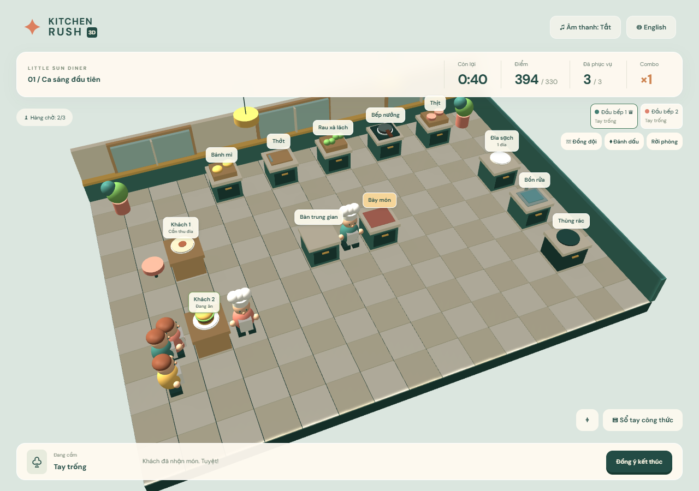

# Kitchen Rush 3D

Game nấu ăn 3D bằng TypeScript, Babylon.js, Vite và Colyseus. **Bản 0.4 ưu tiên Guest:** campaign 5 nhà hàng/50 màn, Solo/co-op 2–4 người, Settings và điều khiển cảm ứng. Mô phỏng gameplay chạy trên Node.js; trình duyệt chỉ gửi ý định di chuyển/tương tác. Account/Database/Economy/Social tạm hoãn, giữ lại mã đã xây dựng. Trạng thái kiểm chứng nằm ở [PROGRESS.md](docs/PROGRESS.md).



Guest 4.3 **3D Pass 1** bổ sung chef/khách có khớp chuyển động, thiết bị bo cạnh, đồ ăn theo từng cuisine và kiến trúc riêng cho cả năm nhà hàng. Xem [gallery desktop/mobile, asset pipeline và hạn chế Pass 2](docs/VISUAL_PASS_1.md). Đây là vòng mỹ thuật đầu tiên; kiểm thử đạt không đồng nghĩa chất lượng đồ họa đã hoàn thiện.

## Chạy local

Cần Node.js 24 và npm. Tại thư mục gốc:

```sh
npm ci
npm run dev
```

Trên Windows PowerShell nếu ExecutionPolicy chặn `npm.ps1`, dùng `npm.cmd` và `npx.cmd` thay cho `npm`/`npx`.

Mở **http://localhost:5173**. Server ở http://localhost:2567; health check: `/health`. Solo và co-op đều cần server local. Hiện ưu tiên Guest, tạm hoãn Account/Economy/Social. Không có `DATABASE_URL` thì game chạy Guest lưu cục bộ. Để chủ động bật Guest kể cả khi môi trường có DB URL: PowerShell `$env:GUEST_ONLY='true'; npm.cmd run dev`. Account và tiến trình đồng bộ vẫn chưa nghiệm thu PostgreSQL.

Nút **Cài đặt** mở Master/Music/SFX Volume, Mute, đồ họa nhẹ và giảm chuyển động. Cài đặt lưu trên thiết bị; mở bảng không dừng trận. Bật âm thanh để nghe nhạc tổng hợp riêng của menu/5 nhà hàng; âm thanh không tự phát trước tương tác. Chế độ nhẹ tắt bóng đổ, giảm độ phân giải render; lựa chọn này không đổi độ khó hoặc trạng thái server.

Trên điện thoại, chọn **Cài đặt → Điều khiển cảm ứng → Joystick + nút tương tác**. Kéo cần theo tám hướng; thả tay để dừng tại tâm ô đang tới. Nút bên phải hiện trạm gần nhất và gửi một thao tác mỗi lần nhấn; viền trạm cho biết mục tiêu. Có thể tiếp tục chạm trạm hoặc đổi về **Chạm để di chuyển**. Dọc/ngang có vùng điều khiển riêng và safe-area. Lệnh vẫn đi qua đường đi theo ô của server, không đổi tốc độ hoặc cân bằng.

Vé khách/hàng chờ có cảnh báo **Sắp bỏ đi**; trạm hiện **Sắp cháy** hoặc trạng thái hoàn tất. Cảnh báo dựa trên snapshot và thời gian của từng màn. Chữ/màu vẫn hoạt động khi mute hoặc giảm chuyển động; SFX dùng âm lượng đã chọn.

## Chơi Multiplayer

Chơi từ mạng khác: xem [hướng dẫn tạo link HTTPS công khai tạm thời](docs/DEPLOYMENT.md#temporary-public-link-from-windows). Bản build hỗ trợ game và WebSocket chung một địa chỉ. Tunnel chưa được khởi động trong môi trường tự động này; chưa có URL public đã xác minh.

1. Chọn **Chơi cùng bạn**, chọn cỡ đội 2, 3 hoặc 4.
2. **Tạo phòng riêng**: chia sẻ mã phòng hoặc dùng **Sao chép lời mời**. Người thứ hai mở trình duyệt/tab khác, chọn **Chơi cùng bạn**, nhập mã và **Vào phòng**. Liên kết `?room=<mã>` cũng vào trực tiếp.
3. Chọn màn đã mở trước khi tìm đội. Chủ phòng riêng có thể đổi màn trong lobby; đổi màn hủy Ready. Tất cả chọn **Sẵn sàng**, chủ phòng chọn **Bắt đầu trận**. Phòng riêng có thể bắt đầu từ 2 người, tối đa bằng cỡ đội đã chọn.
4. **Tìm đội công khai** ghép người thật chọn cùng cỡ đội. Khi đủ 2/3/4 người và tất cả sẵn sàng, trận tự bắt đầu. Không có bot hoặc đồng đội giả.
5. Chia việc: một người lấy đĩa/nướng thịt, người khác cắt rau/bày món/phục vụ. Dùng bàn trung gian để chuyển vật phẩm. Mỗi đầu bếp chỉ cầm một vật phẩm.
6. **Đồng đội** mở Quick Chat và Emote có sẵn. **Đánh dấu** rồi chọn trạm để Ping. Không có chat tự do.
7. Khi đạt cả hai mục tiêu, **Đồng ý kết thúc** gửi phiếu; **Rút phiếu** hủy phiếu. Trận chỉ kết thúc sớm khi mọi thành viên đang kết nối đồng ý. Xem công thức không tạm dừng co-op.

Mất kết nối có **20 giây** để quay lại, giữ nguyên đầu bếp và vật phẩm. Đồng đội tiếp tục chơi. Chủ phòng mới được chọn từ người còn kết nối; chủ cũ quay lại không chiếm lại quyền. Rời hẳn/hết thời hạn sẽ chuyển vật phẩm về bàn trung gian (hàng thu hồi FIFO nếu bàn đầy), bảo toàn đĩa. Lobby chưa bắt đầu tự đóng sau 10 phút.

Độ khó chốt theo màn và số người lúc bắt đầu, không giảm khi có người rời. Mỗi người thêm làm tăng mục tiêu một đơn và 110 điểm; riêng màn đầu, đội 2/3/4 cần 330/440/550 điểm và 3/4/5 đơn. Kết quả co-op lưu riêng theo cỡ đội trên thiết bị, không ghi đè kỷ lục Solo. Chưa có thưởng xu/tài khoản.

Điện thoại cùng mạng LAN: mở `http://<IP-máy-tính>:5173`, cho phép cổng 5173 và 2567 qua firewall. Server URL tự lấy hostname của trang. Có thể đặt `VITE_SERVER_URL` trong `apps/client/.env.local` để thay đổi.

## Campaign

Chọn màn trong menu: Nắng Mai → Thủy Triều → Vườn Ôliu → Đèn Lồng → Quỹ Đạo, mỗi nhà hàng 10 ca. Màn khóa vẫn hiển thị. Thắng nhận 1–3 sao và mở màn kế tiếp; chơi lại không làm mất sao tốt nhất. Màn 5 giới thiệu công thức đặc biệt có nhánh trộn → nướng. Xem sổ công thức và tên món trên vé khách; ghép đúng món trước khi phục vụ.

Tutorial theo ngữ cảnh ở các ca đầu có nút ẩn, không tạm dừng co-op. Public matchmaking ghép cùng màn và cỡ đội. Tiến trình cục bộ chưa chống sửa localStorage; server vẫn quyết định mọi kết quả trận. Xem [thiết kế campaign](docs/CAMPAIGN.md).

## Chơi một ca hoàn chỉnh (màn đầu)

1. Chọn **Vào bếp**. Nhấp/chạm sàn để di chuyển; nhấp vật thể hoặc nhãn trạm để tự đi tới và làm **một** thao tác.
2. Lấy **Đĩa sạch** → **Bày món**.
3. **Thịt** → **Bếp nướng**. Thịt chín sau 7 giây; campaign hiện cho 45 giây sau khi chín trước khi cháy. Cảnh báo xuất hiện trong 5 giây cuối.
4. Trong lúc nấu, **Rau xà lách** → **Thớt** → nhấp thớt 3 lần → nhấp lần nữa để lấy → **Bày món**.
5. Tay trống: lấy thịt chín từ bếp → **Bày món**. Lấy **Bánh mì** → **Bày món**.
6. Tay trống: lấy burger từ bàn bày món → đúng khách đang chờ. Khách ăn rồi để lại đĩa bẩn.
7. Nhặt đĩa bẩn → **Bồn rửa**. Sau 5 giây, lấy đĩa sạch; đặt lại giá đĩa hoặc dùng trực tiếp ở bàn bày món.
8. Đạt **220 điểm và 2 đơn** để thắng. Có thể tiếp tục kiếm sao đến hết 180 giây, hoặc chọn **Kết thúc ca**.

Bàn trung gian chứa một vật phẩm. Thùng rác không nhận đĩa. Cuộn chuột/pinch để zoom, nút ⌖ đặt lại camera. Escape/nút Ⅱ tạm dừng Solo. Sổ tay công thức **không** tạm dừng. Chuyển VI/EN ở góc trên. Âm thanh chỉ bật sau tương tác.

Kỷ lục và kết quả cuối lưu trên thiết bị. Tiến trình mở màn lưu trên thiết bị: thắng màn trước mở màn sau, thắng màn 10 mở nhà hàng tiếp theo. Đây chưa phải tài khoản, tiền tệ hay leaderboard được xác thực.

## Kiểm thử và build

```sh
npm run build
npm test
npx playwright install chromium
npm run test:e2e
npm audit
```

E2E tự khởi động client/server, dùng Chromium thật và click/tap giao diện. Ảnh và trace nằm trong `test-results/`. Xem trạng thái kiểm chứng thực tế ở [docs/PROGRESS.md](docs/PROGRESS.md).

## PostgreSQL và Docker

```sh
docker compose up --build
```

Game: http://localhost:8080. Compose có PostgreSQL, migration/seed, server và Nginx. Hoặc chỉ khởi động database rồi chạy:

```sh
docker compose up -d database
npm run db:migrate
npm run db:seed
```

`DATABASE_URL` nhận qua biến môi trường; giá trị mặc định chỉ dùng local cho migration/seed. Migration SQL có phiên bản, transaction và advisory lock. Migration 002 thêm account, session, guest identity, tiến trình và liên kết match; khi server có `DATABASE_URL`, kết quả do simulation tạo được lưu theo từng người chơi. Nếu chưa cấu hình database, game giữ chế độ Guest cục bộ. PostgreSQL/Docker chưa được chạy kiểm chứng trong lần triển khai hiện tại; xem [PROGRESS.md](docs/PROGRESS.md).

## Cấu trúc

- `apps/client/src/game/scene.ts`: bếp, đầu bếp, NPC, thức ăn procedural và camera.
- `apps/client/src/main.ts`: menu, HUD, sổ công thức, kết nối, kết quả.
- `apps/server/src/simulation/`: state machine, BFS, vật phẩm, khách, điểm và kết quả.
- `apps/server/src/rooms/KitchenRoom.ts`: phòng Colyseus Solo, validation, rate limit và reconnect.
- `apps/server/src/rooms/CoopRoom.ts`: phòng riêng/public, kết nối thật và giới hạn thông điệp.
- `apps/server/src/multiplayer/session.ts`: lobby, Ready, Host, cấu hình đội, phiếu và giao tiếp mẫu.
- `apps/client/src/multiplayer-ui.ts`: lobby, danh sách đồng đội và giao tiếp.
- `packages/content/src/`: schema, catalog 50 màn/10 recipe, validation graph và tiến trình.
- `packages/shared/src/types.ts`: protocol và kiểu dữ liệu chung.
- `database/`: migrations và seed.
- `tests/`: unit/invariant và browser E2E.

Chi tiết: [Kiến trúc](docs/ARCHITECTURE.md), [Gameplay](docs/GAME_DESIGN.md), [Content](docs/CONTENT_SCHEMA.md), [Assets](docs/ASSET_MANIFEST.md), [Test](docs/TEST_PLAN.md), [Triển khai](docs/DEPLOYMENT.md), [Tiến độ](docs/PROGRESS.md).

Nhánh Guest tiếp tục với gameplay feedback, hiệu ứng, animation và tối ưu mobile. Account/Database/Economy/Social đã được tạm hoãn theo yêu cầu; mã database-backed chưa nghiệm thu và không cần cho Guest. Docker/PostgreSQL chưa được chạy kiểm chứng trên máy hiện tại.
