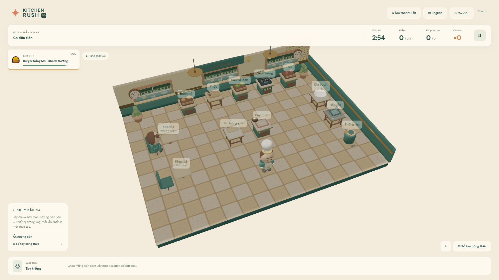
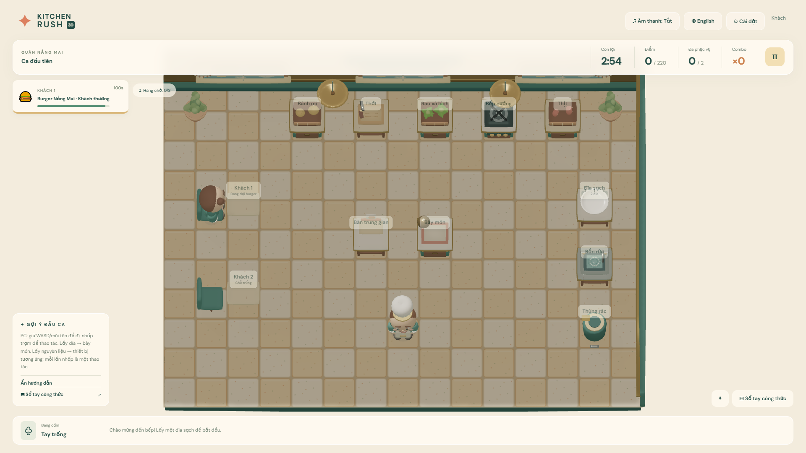
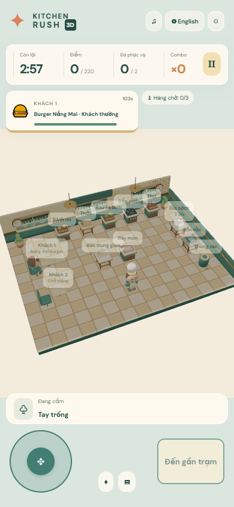
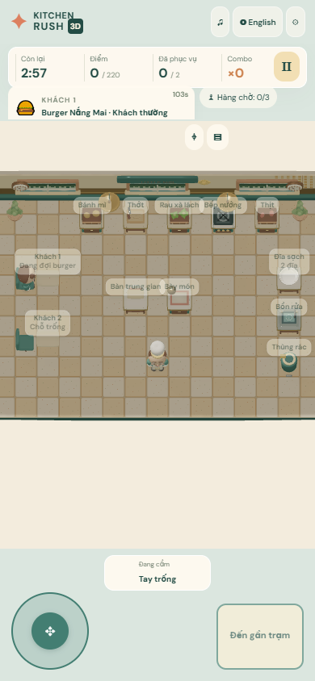
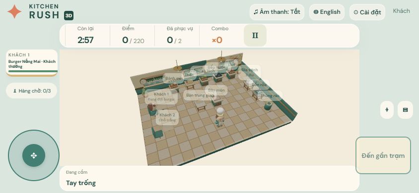
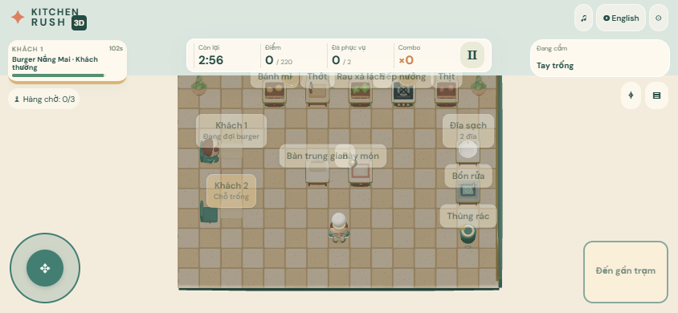
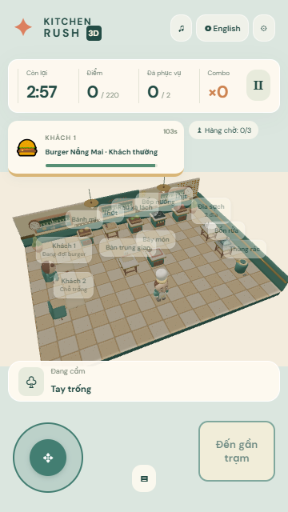
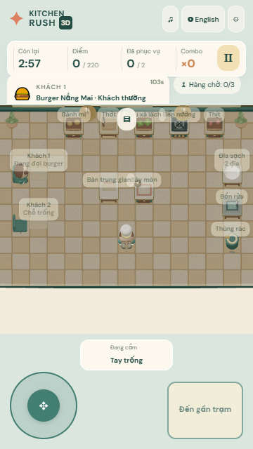
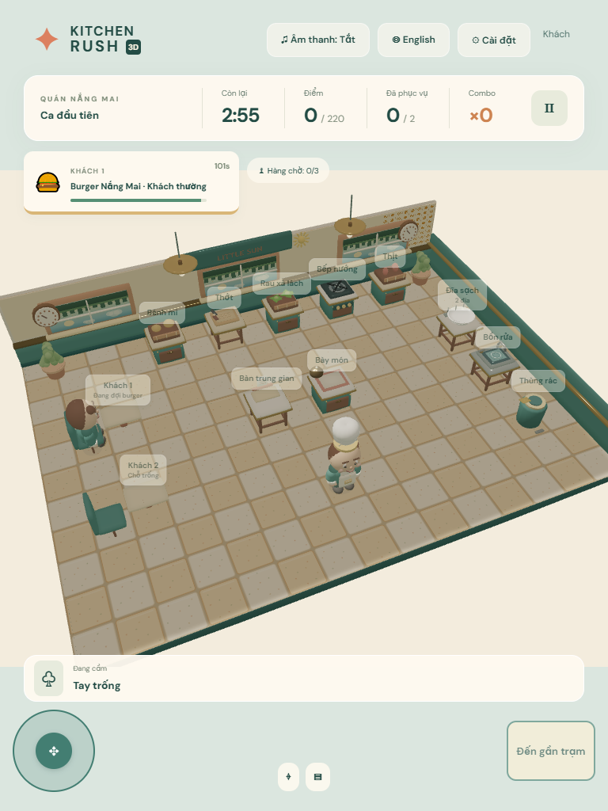
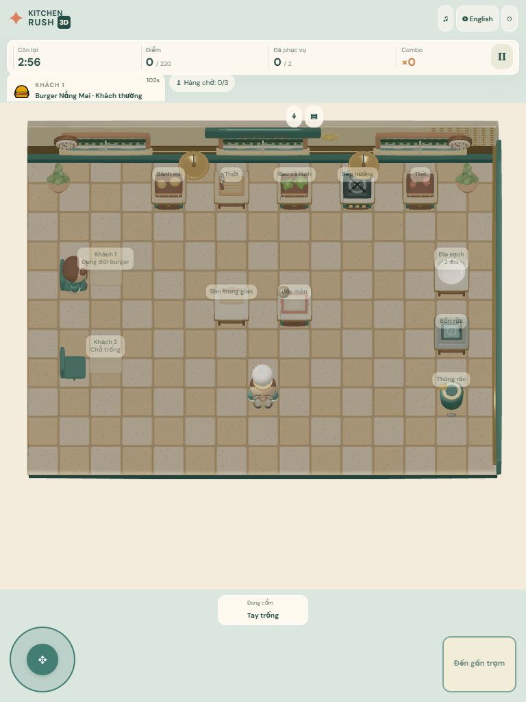

# Guest 4.3 / Pass 3 — Mobile Gameplay

Updated 2026-10-09. This pass reshapes camera framing, touch selection and HUD layout while leaving simulation coordinates, pathfinding, recipe rules and server validation unchanged. Guest remains the active mode; account, database, economy and social development stayed paused.

## Camera decision

I compared the previous perspective view with a high-angle orthographic camera at the same Little Sun Diner level and initial match state. The old view showed the kitchen as a skewed trapezoid, made rows of floor tiles harder to read, and used large empty bands around the kitchen in portrait and landscape. The selected camera uses a fixed isometric azimuth (`alpha = π/2`, `beta = 0.38`) and orthographic projection. Grid spacing stays even across the screen, the character reads more clearly, and a bounded smoothed follow keeps the chef near the useful work area. Zoom is clamped to a safe range. The camera profile is selected from the device viewport, while its frustum is calculated from the actual HUD-reserved canvas.

Desktop starts with an overview framing. Phone portrait prioritizes the room width and chef; landscape uses a closer crop to increase character and station size while retaining all twelve station labels in the tested first shift. A camera button switches between the follow crop and centered overview. Reduced Motion keeps the camera centered and removes movement bob. Low Graphics continues to disable shadows and increase hardware scaling without changing the view or simulation.

| Viewport                 | Playable canvas | Actual orthographic view | Estimated chef height | Stations visible | HUD overlap\* |
| ------------------------ | --------------: | -----------------------: | --------------------: | ---------------: | ------------: |
| PC 1920×1080             |       1920×1080 |        25.24×14.20 units |                122 px |            12/12 |         26.9% |
| Phone portrait 390×844   |  390×530, y=150 |        14.36×19.52 units |                 43 px |            12/12 |          4.0% |
| Phone landscape 844×390  |   844×296, y=94 |        31.53×11.06 units |                 43 px |            12/12 |          9.5% |
| Small phone 360×640      |  360×326, y=150 |        14.36×13.01 units |                 40 px |            12/12 |          3.7% |
| Tablet portrait 768×1024 |  768×710, y=150 |        16.73×15.47 units |                 73 px |            12/12 |          3.7% |

Chef height is estimated from the camera scale and a 1.6-world-unit rig height, not measured from the rendered silhouette. HUD overlap is a sampled union of UI rectangles over the canvas; it is intentionally conservative and does not distinguish a floor tile from a character or station. The desktop figure includes the top bar, score strip, order card and bottom inventory rail.

## Controls and interaction

- Touch keeps the optional left eight-direction joystick and large right action button. The control mode can still be switched to tap-to-move in Settings. Safe-area insets are applied to portrait and landscape control rails.
- Joystick directions are transformed through the camera angle into the existing grid-move intent. Drag dead zone remains 0.22; move intents are throttled to 220 ms and the server retains authority over pathfinding and movement.
- Tapping an empty floor cell sends a normal server move intent. Tapping a station sends an interact intent; it never completes an action locally.
- The action button previews the nearest station within the server's 1.05-tile interaction radius. A 0.32-tile hysteresis avoids target switching when two stations are nearly equidistant. The station gets a focus ring and the button shows the expected action. Invalid/empty actions remain server decisions.
- PC retains mouse station selection and adds camera-relative WASD/arrow movement through the same grid pathfinding protocol. Keyboard input stops when focus is lost or a dialog is open.
- Station labels update at 15 Hz rather than every render. Camera follow mutates existing camera coordinates; it does not create camera vectors each frame. Focus uses one reused marker mesh.

The burger path in the real Little Sun simulation takes 17 station actions: plate, plate set-down, meat, stove, lettuce, board, three chop taps, chopped lettuce retrieval, lettuce assembly, cooked meat retrieval, meat assembly, bun, bun assembly, assembled burger retrieval and service. Walking between stations is server pathfinding and does not require a separate movement command from a station tap.

## Before and after captures

Each capture uses Little Sun level 1, score 0, zero dishes served, one waiting burger order, empty chef inventory and the game paused with the pause veil hidden. The before captures show the prior perspective camera. The after captures use the selected orthographic profile and new reserved canvas layout.

| View              | Before                                                              | After                                                             |
| ----------------- | ------------------------------------------------------------------- | ----------------------------------------------------------------- |
| Desktop 1920×1080 |    |    |
| Portrait 390×844  |    |    |
| Landscape 844×390 |  |  |
| Small 360×640     |    |    |
| Tablet 768×1024   |       |       |

The matching post-capture measurements are stored beside the after screenshots as `*-stats.json`.

## Verification

Final targeted production rerun after the horizontal-axis correction: **11/11 passed in 5.9 minutes** (`mobile-controls.spec.ts` and `mobile-gameplay.spec.ts`). This includes PC/mobile co-op joystick movement, portrait/landscape pick-up and return interactions, mode switching, cooking/customer warnings, all five reference viewports, tap-to-move and WASD. Both joystick tests also passed in a separate 55.2-second run before the axis correction. The full 32-test suite was not repeated after this final client input change. Final format check passed.

Production build/typecheck passed on 2026-10-09. The client bundle still triggers the existing >500 kB chunk warning. Unit/integration regression: **281 passed, 4 skipped**; the skipped tests require PostgreSQL. This includes all 50 levels at each of four team sizes using real simulation movement, cooking, service and washing.

The complete production Playwright run finished with **30 passed, 1 failed, 1 skipped in 26.7 minutes**. The failed portrait joystick test tried to tap a distant station outside the follow crop. It now uses the player-facing overview button before picking up a plate, returns it with the nearby interaction button, and switches to tap controls. The account test is skipped without a database. A targeted final rerun is recorded below.

Coverage in the complete run: Solo cooking/service/wash/reuse/win and Guest progress, mobile pause/reconnect/language, simultaneous PC/mobile room movement, two browsers cooking and washing together with reconnect and synchronized score, Settings without pausing, warnings, five viewport captures, and ten restaurant render checks. Campaign browser tests select all 50 menu entries, validate their recipe references, and cook/serve level 1 in each restaurant; they do **not** play all 50 matches to completion in a browser.

Final control review also corrected a mirrored horizontal input axis for Babylon's left-handed camera. Joystick and WASD now map screen-right to world -X at the selected azimuth; simulation coordinates and server validation remain unchanged.

Run locally in PowerShell:

```powershell
$env:GUEST_ONLY='true'
npm.cmd run build
npm.cmd test
$env:E2E_PRODUCTION='true'
npm.cmd run test:e2e
npm.cmd run format:check
```

The restaurant visual regression currently writes the existing `*-43-pass2-*` screenshot filenames. Those files were refreshed with the Pass 3 camera during this run; the dedicated `pass3-before/` images remain the camera comparison baseline.

## Remaining UX work

- The portrait capture still has unused vertical floor space and a small rendered chef silhouette. The 40–43 px camera estimate is not a readability acceptance score; character and held-item recognition need physical-phone playtesting and further framing refinement.
- Screenshots and multiplayer clients in this pass use Chromium with simulated touch and software rendering. I have not tested on a physical Android/iPhone, notch/safe-area hardware, or compared touch latency and frame time on a phone GPU.
- Dense station labels still converge near the rear counter row on narrow screens. Their text is smaller there; a later UI pass should test a collision-aware label layout on real devices.
- The landscape and portrait camera profiles are tuned against the Little Sun station layout. All five restaurants passed desktop/mobile render captures, but their moving-camera crops and busy late-level states still need hands-on review before considering the layouts final.
- No physical-device performance benchmark was taken. The existing Chromium/SwiftShader renderer instrumentation is not a mobile GPU benchmark.
