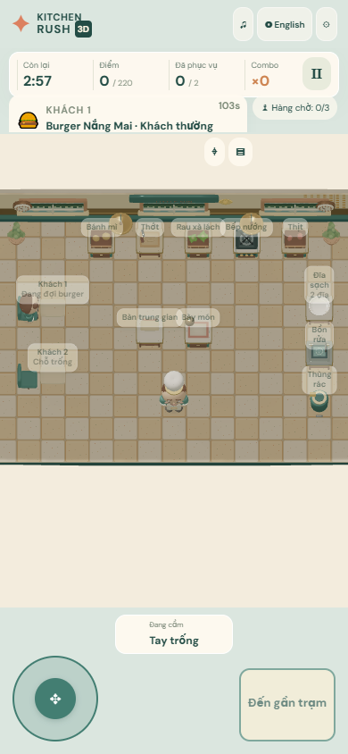
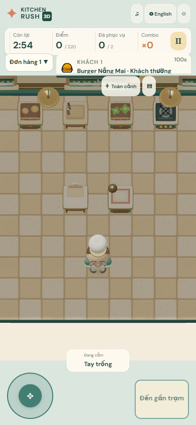
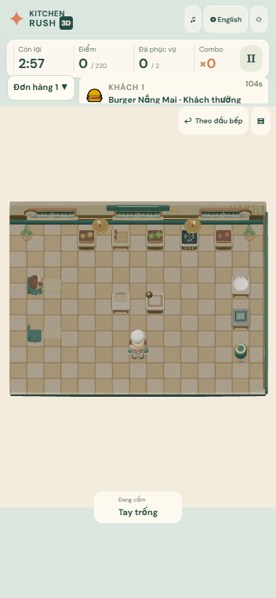
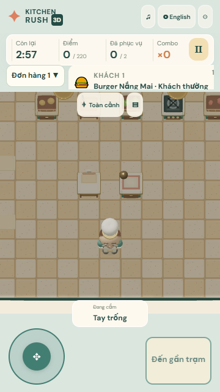

# Guest 4.3 / Pass 5B — Mobile Portrait Layout & Readability

Pass 5B addresses the cramped portrait play area and makes the camera modes and station labels easier to understand. It keeps the Guest flow, simulation rules, server authority, Retina resolution settings, and desktop controls intact.

## Diagnosis and changes

The 390×844 Pass 4 screenshot showed a 390×530 CSS canvas between the HUD and touch controls. More importantly, the canvas element's intrinsic height could override the intended portrait height when CSS set `height:auto`; the screenshot clipped the element at the viewport while Babylon measured it as 844px tall. That made the orthographic camera calculate a much taller world view than the player actually saw. The portrait camera also kept a wide-kitchen minimum width, leaving large unused areas around the kitchen.

The portrait canvas now has an explicit viewport-relative height between the HUD/order rail and lower touch controls, including `safe-area-inset` offsets. At 390×844 the measured canvas is 390×566 CSS pixels. Portrait Follow zoom is calculated from the real canvas aspect and height, capped at 1.82, with a lower fit limit on short screens. On the 360×640 reference it selects 1.51 so the kitchen remains inside the narrow playable frame. Follow framing tracks the chef; Overview zooms out to show the complete restaurant. Resizing recomputes the camera profile and retains the selected Overview/Follow mode. Reduced Motion snaps to the bounded Follow target without camera easing.

Portrait shows nearby, targeted, ready, burning, or otherwise important station labels by default. Distant idle labels stay hidden unless **Show all station labels** is enabled in Settings. Visible labels are moved away from the chef and each other where room allows; hidden labels are also removed from pointer and keyboard interaction. Orders stay horizontally scrollable, with a touch-sized expand/collapse control when the ticket rail fills. Settings continues to leave the match running.

Camera telemetry on `#game[data-camera-stats]` now includes the profile, current zoom and bounds, estimated chef screen height, visible stage bounds and area share, visible/overlapping labels, and labels hidden to avoid collisions. The existing resolution diagnostics continue to report CSS and drawing-buffer sizes, DPR, effective render scale, FPS/frame time, and renderer information.

## Before and after captures

These are full-page Chromium production captures of Little Sun 01. They are not Safari/iPhone photographs.

| Before — Pass 4, portrait 390×844                                         | After — Pass 5B Follow, portrait 390×844                                            |
| ------------------------------------------------------------------------- | ----------------------------------------------------------------------------------- |
|  |  |

The Follow camera uses the available portrait area for the kitchen and chef. The chef estimate rises from about 53px at the old 1.10 zoom to 88px at the new 1.82 zoom. The projected kitchen footprint rises from roughly 58% to 81.1% of the canvas. The separate Overview capture keeps the full room visible at once.

| Overview — portrait 390×844                                                    | Narrow phone — Follow, 360×640                                               |
| ------------------------------------------------------------------------------ | ---------------------------------------------------------------------------- |
|  |  |

## Reference viewport measurements

Screenshots and complete JSON measurements are in [`docs/screenshots/pass5b`](screenshots/pass5b). Values below are captured from the production client in Chromium with SwiftShader; canvas and character dimensions are CSS-pixel estimates, not physical-device measurements.

| Viewport                         |    Canvas | Camera           | Zoom | Chef estimate | Kitchen footprint | Sampled HUD/control coverage | Label overlaps |
| -------------------------------- | --------: | ---------------- | ---: | ------------: | ----------------: | ---------------------------: | -------------: |
| iPhone 13 class, 390×844         |   390×566 | Mobile portrait  | 1.82 |          88px |             81.1% |                         5.9% |              0 |
| iPhone 14 Pro Max class, 430×932 |   430×654 | Mobile portrait  | 1.82 |          97px |             77.4% |                         5.3% |              0 |
| Narrow phone, 360×640            |   360×362 | Mobile portrait  | 1.51 |          67px |             92.8% |                         5.7% |              0 |
| Landscape, 844×390               |   844×296 | Mobile landscape | 1.04 |          52px |             42.6% |                        11.5% |              0 |
| Tablet, 768×1024                 |   768×710 | Tablet portrait  | 1.04 |          90px |             59.2% |                         3.7% |              0 |
| Desktop, 1920×1080               | 1920×1080 | Desktop overview | 1.00 |         122px |             42.7% |                        26.9% |              0 |

“Kitchen footprint” is the visible projected floor bounding rectangle as a percentage of the canvas. “Sampled coverage” is the E2E grid estimate of pixels covered by HUD/control rectangles; it is not a GPU occlusion measurement. Desktop coverage includes its large HUD bounds and should not be compared directly with the portrait touch layout.

## Verification and limits

- `npm run build`: passed, including typecheck, production client build, and server bundle.
- Focused production `mobile-gameplay.spec.ts`: 9 passed. It captures all six reference viewports, checks the compact order rail and touch action target, switches Overview/Follow, validates touch floor picking, and validates desktop WASD movement.
- `npm test`: 286 passed; 4 PostgreSQL-dependent tests skipped in Guest-only mode.
- Focused production verification: 9/9 mobile gameplay checks passed across the six viewport references, Overview/Follow, touch floor picking, and desktop WASD. The real cooking-warning and mobile Settings/reduced-motion checks also passed after fixing stable order DOM and updating the mobile warning test to allow its full simulation window.
- Full Guest production Playwright suite: **35 passed, 1 skipped in 30.4 minutes**. The skipped test is Account E2E because PostgreSQL is not configured. Covered campaign gameplay across five restaurants, full Solo win/persistence, two-client co-op/reconnect, joystick/touch, warnings, six viewport sizes, camera/picking, WASD, Retina/orientation, Settings and ten restaurant visual captures.
- `npm run format:check`: passed. `git diff --check`: passed (Git reports its existing LF-to-CRLF working-copy notices).

The viewport matrix uses Chromium's SwiftShader renderer. It cannot establish sharpness, safe-area behavior, or touch comfort on Safari running on an iPhone 13 or iPhone 14 Pro Max. Those devices still need a hands-on check. The 360×640 layout necessarily trades overall-room visibility for large touch controls; use Overview when the whole kitchen needs to be surveyed. Portrait Follow intentionally crops distant stations to keep the chef and current work area large; settings can reveal idle labels, and Overview remains one tap away. No simulation or campaign-balance values were changed.

## Evidence scope and remaining acceptance

- The six viewport captures are early-match references. The reported zero overlapping labels applies to those captures, not every simultaneous warning or four-player arrangement.
- Before/after full-page pairs exist for 360 x 640, 390 x 844, 844 x 390, 768 x 1024 and 1920 x 1080 (`screenshots/pass4-after` versus `screenshots/pass5b`). The 430 x 932 capture has no matching pre-change baseline; it is an after-only reference.
- Cooking/warnings, carried items, Settings and reconnect are exercised by separate gameplay tests. A four-client visual stress capture and a complete state-by-viewport matrix remain outstanding.
- Legacy long-form recipe tests use Overview for stable world-label clicks. Dedicated Follow, floor picking, WASD and joystick tests still exercise movement. No forced clicks or injected match results are needed by these recipe tests.
- The restored order-content wrapper keeps tickets visible; the empty rail passes pointer input through while its buttons remain interactive.
- On iPhone 13 and 14 Pro Max, check portrait/landscape in Safari using Balanced + Retina balanced, including browser toolbar expansion, safe areas, joystick, held food and several urgent orders. Enable Render diagnostics and record CSS/buffer/effectiveScale. Physical-device blur acceptance remains pending.

### Full-screen viewport evidence

| Viewport    | Before                                                  | After                                                                                                                  |
| ----------- | ------------------------------------------------------- | ---------------------------------------------------------------------------------------------------------------------- |
| 360 x 640   | [Pass 4](screenshots/pass4-after/small-360x640.png)     | [Pass 5B](screenshots/pass5b/small-360x640-follow.png)                                                                 |
| 390 x 844   | [Pass 4](screenshots/pass4-after/portrait-390x844.png)  | [Follow](screenshots/pass5b/portrait-390x844-follow.png), [Overview](screenshots/pass5b/portrait-390x844-overview.png) |
| 430 x 932   | No matching baseline                                    | [Pass 5B](screenshots/pass5b/portrait-430x932-follow.png)                                                              |
| 844 x 390   | [Pass 4](screenshots/pass4-after/landscape-844x390.png) | [Pass 5B](screenshots/pass5b/landscape-844x390-follow.png)                                                             |
| 768 x 1024  | [Pass 4](screenshots/pass4-after/tablet-768x1024.png)   | [Pass 5B](screenshots/pass5b/tablet-768x1024-follow.png)                                                               |
| 1920 x 1080 | [Pass 4](screenshots/pass4-after/desktop-1920x1080.png) | [Pass 5B](screenshots/pass5b/desktop-1920x1080-follow.png)                                                             |

Visual review: portrait uses substantially more of the canvas for the chef and kitchen, while distant workstations and seats are cropped in Follow. The 360 x 640 view keeps large controls but has less context. Landscape keeps the full room and side controls, with a smaller chef than portrait. The order rail can clip a long ticket until horizontally scrolled or expanded. None of these captures establish final art quality or physical-device touch comfort.
